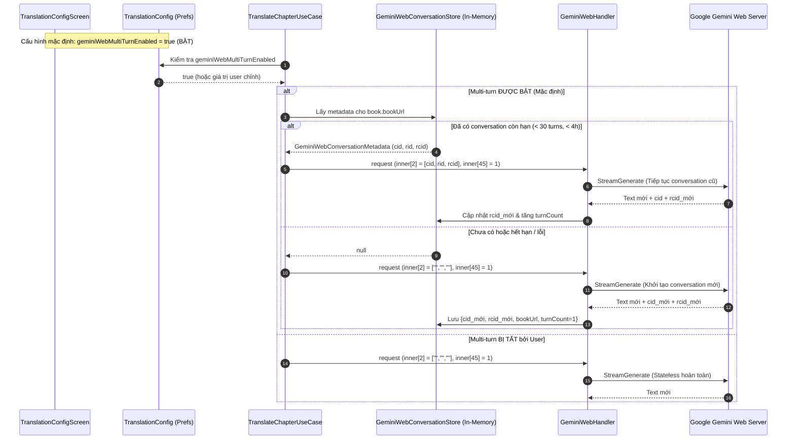

# Phase 03: Quản Lý Ngữ Cảnh Hội Thoại Nhiều Lượt [cid, rid, rcid] + Book-Scoped Conversation Routing

> **Thuộc kế hoạch:** `PLN-261014-1845` — Gemini Web Advanced Enhancements  
> **Trạng thái:** 🟡 Sẵn sàng triển khai  
> **Cập nhật:** 2026-10-14T19:35:00+07:00 — Chuẩn hóa: **BẬT MẶC ĐỊNH (Enabled by Default), Có Toggle Tắt Trong Cài Đặt**  
> **Các file tác động chính:**
> - `app/src/main/java/io/legado/app/data/repository/ai/GeminiWebHandler.kt`
> - `app/src/main/java/io/legado/app/data/repository/ai/GeminiWebSessionManager.kt`
> - `app/src/main/java/io/legado/app/domain/model/AiModels.kt` (`AiGenerateRequest`, `AiGenerateResponse`, `AiTaskRuntimeOptions`)
> - `app/src/main/java/io/legado/app/ui/config/translation/TranslationConfig.kt`
> - `app/src/main/java/io/legado/app/constant/PreferKey.kt`
> - `app/src/main/java/io/legado/app/ui/config/translation/TranslationConfigScreen.kt`
> - `app/src/main/java/io/legado/app/domain/usecase/TranslateChapterUseCase.kt`

---

## 1. Vấn Đề Cốt Lõi & Yêu Cầu Từ User

### 1.1. Ma Trận Tác Vụ & Chế Độ Ngữ Cảnh (Multi-Turn Matrix)

| Tác Vụ | Tính Chất | Trạng Thái Multi-Turn | Lý Do & Giá Trị Mang Lại |
|---|---|---|---|
| **Dịch nhiều chương liên tiếp cùng 1 truyện** (`TRANSLATE_CHAPTER`) | Bán liên tục (Semi-continuous) | 🟢 **BẬT MẶC ĐỊNH** (Có thể tắt) | Gemini "nhớ" tên nhân vật, thuật ngữ, văn phong đã giải quyết ở các chương trước → tăng tính nhất quán xuyên suốt bộ truyện. |
| **Chat Trợ lý AI đọc truyện** (`CHAT`) | Liên tục (Stateful) | 🟢 **BẬT MẶC ĐỊNH** | Giảm 80%+ băng thông do không cần gửi lại lịch sử, phản hồi tức thì. |
| **Dịch đơn lẻ từng chương độc lập** | Độc lập | ⚪ **Tự động hỗ trợ** | Nếu người dùng tắt tính năng trong Cài đặt, mỗi chương là 1 request độc lập hoàn toàn. |
| **Tóm tắt chương / sách** (`SUMMARIZE_*`) | Độc lập | ❌ **TẮT** | Không dùng chung hội thoại để tránh nhiễu tóm tắt. |

### 1.2. Yêu Cầu Từ User (2026-10-14)

> *"Làm sao để cùng 1 truyện, lần gửi dịch sau gửi vào đúng đoạn chat trước đó? Bật mặc định, cho phép tắt. Cập nhật và hoàn thiện plan."*

**Định hướng chỉ đạo:**
1. **Bật mặc định (`true`):** Các lượt dịch kế tiếp của cùng một cuốn truyện sẽ tự động được gửi vào chung đoạn chat Gemini Web trước đó thông qua `routeSessionKey` (`book.bookUrl`).
2. **Cho phép tắt:** Người dùng có thể vào màn hình **Cài đặt dịch thuật (TranslationConfigScreen)** để gạt công tắc tắt tính năng này nếu muốn mỗi chương độc lập tuyệt đối.
3. **Cơ chế an toàn tự động (Auto Safety Net):** Giới hạn tối đa 30 turns/conversation, thời gian sống TTL 4 giờ, tự động reset conversation mới khi chuyển model, và tự động fallback sang stateless nếu hội thoại cũ gặp lỗi phía Google.

---

## 2. Kế Thừa Kỹ Thuật Từ `gemini-web-to-api`

Qua phân tích `gemini_chat_session.go` và `gemini_service.go` (dòng 1079–1096):

### 2.1. Trích Xuất Bộ Ba Định Danh `[cid, rid, rcid]` Từ Response

```
Response envelope (Google batchexecute inner JSON array):
├── inner[1]  → cid (Conversation ID, chuỗi bắt đầu bằng "c_" hoặc chuỗi định danh phiên)
│              - Nếu là String: dùng trực tiếp làm cid
│              - Nếu là Array: lấy phần tử đầu tiên array[0]
├── inner[4]  → candidates list: [["rc_xxx", ["text", ...], ...], ...]
│   └── candidates[0][0] → rcid (Response Choice ID, chuỗi bắt đầu bằng "rc_")
└── rid       → Nằm trong candidates metadata hoặc đồng bộ với rcid
```

### 2.2. Cấu Trúc Khối `inner[2]` (Conversation Context Metadata)

- **Khi khởi tạo đoạn chat mới (hoặc khi tắt multi-turn):**
  `inner[2] = ["", "", "", null, null, null, null, null, null, ""]`

- **Khi tiếp tục đoạn chat cũ của cùng truyện:**
  `inner[2] = [cid, rid, rcid, null, null, null, null, null, null, ""]`

### 2.3. Cờ `isTemporary` Tại `inner[45]`

```
inner[45] = 1  → Chat tạm thời (Temporary): Gemini KHÔNG ghi vào danh sách lịch sử chat của user
inner[45] = 0  → Chat vĩnh viễn: Gemini lưu từng chương vào lịch sử tài khoản Google → gây spam chat list
```

**Quyết định chuẩn mực cho DrDucBook:**
- Luôn đặt `inner[45] = 1` để giữ tài khoản Google của người dùng hoàn toàn sạch sẽ, không bị tràn hàng trăm tiêu đề chương truyện vào giao diện web gemini.google.com, nhưng vẫn tái sử dụng được ngữ cảnh qua `cid`.

---

## 3. Thiết Kế Chi Tiết: Book-Scoped Conversation Routing

### 3.1. Kiến Trúc Luồng Xử Lý (Sequence Diagram)



---

## 4. Đặc Tả Thành Phần Code Cụ Thể

### 4.1. Bộ Lưu Trữ In-Memory: `GeminiWebConversationStore`

Đặt trong `GeminiWebSessionManager.kt`, bảo toàn tính an toàn theo tiến trình, không gây phình database Room:

```kotlin
data class GeminiWebConversationMetadata(
    val cid: String,            // Conversation ID từ Google (c_...)
    val rid: String,            // Last Response ID
    val rcid: String,           // Last Response Choice ID (rc_...)
    val model: String,          // Model ID đã sử dụng (để reset nếu user đổi model)
    val updatedAt: Long = System.currentTimeMillis(),
    val turnCount: Int = 1,     // Số lượt dịch trong cùng đoạn chat
)

object GeminiWebConversationStore {
    private const val MAX_CONVERSATIONS = 50
    private const val MAX_TURNS_PER_CONVERSATION = 30   // Google hạn chế chất lượng khi > 30-40 turns
    private const val CONVERSATION_TTL_MS = 4 * 60 * 60 * 1000L  // 4 giờ

    private val conversations = ConcurrentHashMap<String, GeminiWebConversationMetadata>()

    /** Lấy metadata còn hiệu lực theo khóa bookUrl */
    fun get(sessionKey: String, currentModelId: String): GeminiWebConversationMetadata? {
        val meta = conversations[sessionKey] ?: return null
        val now = System.currentTimeMillis()

        // 1. Kiểm tra TTL 4 giờ
        if (now - meta.updatedAt > CONVERSATION_TTL_MS) {
            conversations.remove(sessionKey)
            return null
        }
        // 2. Kiểm tra giới hạn số lượt (quá 30 turns thì tự làm mới conversation để tránh quá tải token)
        if (meta.turnCount >= MAX_TURNS_PER_CONVERSATION) {
            conversations.remove(sessionKey)
            return null
        }
        // 3. Kiểm tra model có bị thay đổi không
        if (meta.model.isNotBlank() && meta.model != currentModelId) {
            conversations.remove(sessionKey)
            return null
        }

        return meta
    }

    /** Lưu hoặc cập nhật metadata sau mỗi lần dịch thành công */
    fun put(sessionKey: String, meta: GeminiWebConversationMetadata) {
        evictOldEntriesIfNeeded()
        conversations[sessionKey] = meta
    }

    /** Xóa phiên của một cuốn truyện cụ thể (khi user bấm reset hoặc gặp lỗi) */
    fun remove(sessionKey: String) {
        conversations.remove(sessionKey)
    }

    /** Xóa toàn bộ khi session cookie bị hủy */
    fun clearAll() {
        conversations.clear()
    }

    private fun evictOldEntriesIfNeeded() {
        if (conversations.size >= MAX_CONVERSATIONS) {
            val oldestKey = conversations.entries.minByOrNull { it.value.updatedAt }?.key
            if (oldestKey != null) conversations.remove(oldestKey)
        }
    }
}
```

---

### 4.2. Mở Rộng Cấu Hình Tùy Chọn: `AiTaskRuntimeOptions` & `TranslationConfig`

#### 1. `AiModels.kt` — Thêm cờ vào `AiTaskRuntimeOptions`:
```kotlin
@Keep
data class AiTaskRuntimeOptions(
    val targetLanguage: String = DEFAULT_TARGET_LANGUAGE,
    val maxInputChars: Int = DEFAULT_MAX_INPUT_CHARS,
    val concurrentRequests: Int = DEFAULT_CONCURRENT_REQUESTS,
    val retryCount: Int = DEFAULT_RETRY_COUNT,
    val routeProfileId: String = "",
    val geminiWebSkillName: String? = null,
    val geminiWebSkillCompactMode: Boolean = true,
    /** BẬT MẶC ĐỊNH: Cho phép gửi các chương cùng truyện vào chung conversation Gemini Web */
    val geminiWebMultiTurn: Boolean = true,
)
```

#### 2. `PreferKey.kt` — Thêm khóa lưu trữ SharedPreferences:
```kotlin
const val geminiWebMultiTurnEnabled = "geminiWebMultiTurnEnabled"
```

#### 3. `TranslationConfig.kt` — Khai báo thuộc tính truy cập nhanh:
```kotlin
var geminiWebMultiTurnEnabled by prefDelegate(
    PreferKey.geminiWebMultiTurnEnabled,
    true, // ★ BẬT MẶC ĐỊNH (Enabled by default)
)
```

#### 4. `TranslationConfigScreen.kt` — Thêm Toggle trực quan cho User:
Trong mục Cài đặt AI Dịch thuật, thêm thành phần Switch để người dùng bật/tắt:
```kotlin
AppSwitchPreference(
    title = stringResource(R.string.gemini_web_multiturn_title), // "Duy trì hội thoại cùng truyện (Gemini Web)"
    summary = stringResource(R.string.gemini_web_multiturn_summary), // "Tự động gửi các chương của cùng một truyện vào chung đoạn chat Gemini Web để ghi nhớ tên nhân vật và thuật ngữ. Tắt nếu muốn mỗi chương dịch độc lập hoàn toàn."
    checked = TranslationConfig.geminiWebMultiTurnEnabled,
    onCheckedChange = { TranslationConfig.geminiWebMultiTurnEnabled = it },
)
```

---

### 4.3. Cập Nhật `GeminiWebHandler.kt`

#### 1. Mở rộng `buildFReqPayload`:
```kotlin
internal fun buildFReqPayload(
    prompt: String,
    modelId: String = "",
    conversationMeta: GeminiWebConversationMetadata? = null,
): String {
    val (geminiModelCode, thinkMode) = resolveGeminiWebModelSpec(modelId)

    // Khởi tạo mảng innerArray chuẩn 81 phần tử
    val innerArray = JsonArray()
    for (i in 0 until 81) {
        innerArray.add(JsonNull.INSTANCE)
    }

    innerArray.set(0, JsonArray().apply {
        add(prompt)
        add(0)
        add(JsonNull.INSTANCE)
        add(JsonNull.INSTANCE)
        add(JsonNull.INSTANCE)
        add(JsonNull.INSTANCE)
        add(0)
    })
    innerArray.set(1, JsonArray().apply { add("vi") })

    // ★ Gắn metadata hội thoại vào inner[2]
    innerArray.set(2, JsonArray().apply {
        if (conversationMeta != null && conversationMeta.cid.isNotBlank()) {
            add(conversationMeta.cid)   // cid
            add(conversationMeta.rid)   // rid
            add(conversationMeta.rcid)  // rcid
        } else {
            add("")
            add("")
            add("")
        }
        add(JsonNull.INSTANCE)
        add(JsonNull.INSTANCE)
        add(JsonNull.INSTANCE)
        add(JsonNull.INSTANCE)
        add(JsonNull.INSTANCE)
        add(JsonNull.INSTANCE)
        add("")
    })

    innerArray.set(6, JsonArray().apply { add(1) })
    innerArray.set(7, JsonPrimitive(1))
    innerArray.set(10, JsonPrimitive(1))
    innerArray.set(11, JsonPrimitive(0))
    innerArray.set(17, JsonArray().apply {
        add(JsonArray().apply { add(thinkMode) })
    })
    innerArray.set(18, JsonPrimitive(0))
    innerArray.set(27, JsonPrimitive(1))
    innerArray.set(30, JsonArray().apply { add(4) })
    innerArray.set(41, JsonArray().apply { add(1) })

    // ★ inner[45]: isTemporary flag — luôn bật để giữ sạch tài khoản
    innerArray.set(45, JsonPrimitive(1))

    innerArray.set(53, JsonPrimitive(0))
    innerArray.set(59, JsonPrimitive(UUID.randomUUID().toString()))
    innerArray.set(61, JsonArray())
    innerArray.set(68, JsonPrimitive(1))
    innerArray.set(79, JsonPrimitive(geminiModelCode))
    innerArray.set(80, JsonPrimitive(1))

    val outerArray = JsonArray().apply {
        add(JsonNull.INSTANCE)
        add(COMPACT_GSON.toJson(innerArray))
    }
    return COMPACT_GSON.toJson(outerArray)
}
```

#### 2. Trích xuất `cid` và `rcid` từ gói tin phản hồi `wrb.fr`:
```kotlin
internal fun extractConversationMetadata(innerJson: String): Pair<String?, String?> {
    val trimmed = innerJson.trim()
    if (!trimmed.startsWith("[")) return Pair(null, null)
    return runCatching {
        val inner = COMPACT_GSON.fromJson(trimmed, JsonElement::class.java)
        if (!inner.isJsonArray) return@runCatching Pair(null, null)
        val arr = inner.asJsonArray

        // 1. Trích xuất cid từ arr[1]
        val cid = when {
            arr.size() > 1 && arr[1].isJsonPrimitive -> arr[1].asString.takeIf { it.isNotBlank() }
            arr.size() > 1 && arr[1].isJsonArray && arr[1].asJsonArray.size() > 0 ->
                arr[1].asJsonArray[0].asString.takeIf { it.isNotBlank() }
            else -> null
        }

        // 2. Trích xuất rcid từ arr[4][0][0]
        var rcid: String? = null
        if (arr.size() > 4 && arr[4].isJsonArray) {
            val candidates = arr[4].asJsonArray
            if (candidates.size() > 0 && candidates[0].isJsonArray) {
                val cand0 = candidates[0].asJsonArray
                if (cand0.size() > 0 && cand0[0].isJsonPrimitive) {
                    rcid = cand0[0].asString.takeIf { it.isNotBlank() }
                }
            }
        }

        Pair(cid, rcid)
    }.getOrDefault(Pair(null, null))
}
```

#### 3. Điều phối luồng trong `streamInternal`:
```kotlin
// Xác định có kích hoạt multi-turn không (mặc định = true từ cấu hình)
val sessionKey = request.routeSessionKey
val multiTurnEnabled = request.providerMetadata["multiTurn"] != "false" &&
    !sessionKey.isNullOrBlank()

val conversationMeta = if (multiTurnEnabled) {
    GeminiWebConversationStore.get(sessionKey!!, request.model.modelId)
} else null

// Nếu gửi cid cũ mà bị lỗi "conversation not found" hoặc RPC error, tự động xóa meta và retry 1 lần dạng stateless
```

---

## 5. Kịch Bản Khôi Phục Lỗi Tự Động (Auto-Recovery & Edge Cases)

1. **Lỗi "Conversation Not Found" / Token Limit:**
   - Nếu Google Gemini phản hồi lỗi do cuộc hội thoại quá dài hoặc `cid` bị hủy phía máy chủ:
   - Handler bắt ngoại lệ, lập tức gọi `GeminiWebConversationStore.remove(sessionKey)`.
   - Tự động phát lại request ở chế độ tạo cuộc hội thoại mới (`inner[2]` rỗng), đảm bảo bản dịch **không bao giờ bị gián đoạn hay báo lỗi ra ngoài giao diện người dùng**.

2. **Chuyển Đổi Model Giữa Chừng:**
   - Nếu ở Chương 1 người dùng chọn `3.5 Flash-Lite`, sang Chương 2 đổi sang `4 Argon`:
   - `GeminiWebConversationStore.get()` phát hiện lệch model (`meta.model != currentModelId`) $\rightarrow$ tự động giải phóng session cũ và mở session mới theo đúng model chỉ định.

3. **Xoay Vòng Cookie (`RotateCookies`):**
   - Khi cookie được làm mới trong Phase 01, `GeminiWebConversationStore.clearAll()` được kích hoạt để tránh gửi `cid` cũ trên phiên cookie mới.

---

## 6. Checklist Thay Đổi Code Chi Tiết

| STT | Tập Tin | Thay Đổi Cụ Thể |
|---|---|---|
| 1 | `app/src/main/java/io/legado/app/constant/PreferKey.kt` | Thêm `const val geminiWebMultiTurnEnabled = "geminiWebMultiTurnEnabled"` |
| 2 | `app/src/main/java/io/legado/app/ui/config/translation/TranslationConfig.kt` | Thêm `var geminiWebMultiTurnEnabled by prefDelegate(..., true)` (**mặc định true**) |
| 3 | `app/src/main/java/io/legado/app/domain/model/AiModels.kt` | - `AiTaskRuntimeOptions.geminiWebMultiTurn: Boolean = true`<br>- `AiGenerateResponse.conversationId: String? = null`<br>- `AiGenerateRequest.providerMetadata: Map<String, String> = emptyMap()` |
| 4 | `app/src/main/java/io/legado/app/data/repository/ai/GeminiWebSessionManager.kt` | Thêm `GeminiWebConversationStore` + `GeminiWebConversationMetadata` (TTL 4h, max 30 turns) |
| 5 | `app/src/main/java/io/legado/app/data/repository/ai/GeminiWebHandler.kt` | - `buildFReqPayload()` nhận `conversationMeta`, điền `inner[2]`, thêm `inner[45]=1`<br>- Thêm hàm `extractConversationMetadata()` bóc tách `cid` và `rcid`<br>- `streamInternal()` tích hợp luồng get/put conversation |
| 6 | `app/src/main/java/io/legado/app/ui/config/translation/TranslationConfigScreen.kt` | Bổ sung Switch toggle trong giao diện Cài đặt dịch thuật |
| 7 | `app/src/main/res/values/strings.xml` & `values-vi/strings.xml` | Bổ sung chuỗi hiển thị: `gemini_web_multiturn_title`, `gemini_web_multiturn_summary` |

---

## 7. Tiêu Chí Nghiệm Thu (Acceptance Criteria)

- [ ] **Bật Mặc Định Hoàn Hảo:** Khi người dùng dịch truyện bằng Gemini Web mà không chỉnh sửa gì thêm, các chương liên tiếp tự động liên kết vào chung 1 conversation trên máy chủ Google.
- [ ] **Nhớ Ngữ Cảnh Xuyên Chương:** Gemini giữ được cách xưng hô và dịch tên nhân vật đã thỏa thuận từ chương trước mà không cần nhồi lại toàn bộ text vào prompt.
- [ ] **Cho Phép Tắt Linh Hoạt:** Khi người dùng gạt tắt công tắc trong Cài đặt dịch thuật, app lập tức chuyển sang chế độ stateless độc lập từng chương.
- [ ] **Không Rác Lịch Sử Google:** Nhờ cờ `inner[45] = 1`, tài khoản Google của người dùng không bao giờ bị spam danh sách chat.
- [ ] **Tự Hồi Phục Khi Quá Tải:** Sau 30 chương hoặc khi gặp lỗi hội thoại cũ, app tự động mở hội thoại mới một cách mượt mà, không gián đoạn việc đọc.
