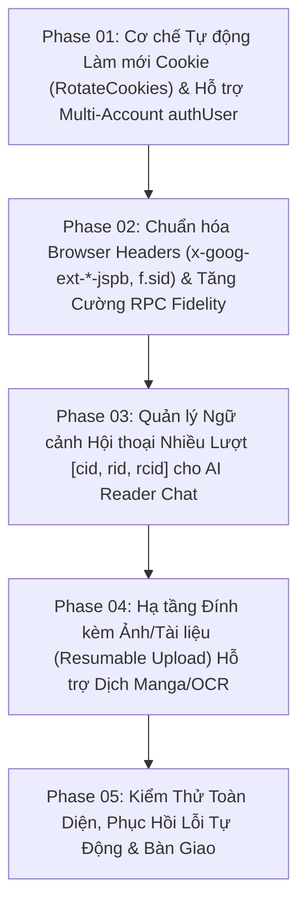

# Plan: Hoàn Thiện & Nâng Cấp Gemini Web Cho DrDucBook (Đối Chiếu & Kế Thừa Tinh Hoa Từ gemini-web-to-api) — Milestone P78

> **Mã kế hoạch:** `PLN-261014-1845`  
> **Đường dẫn:** `plans/261014-1845-gemini-web-advanced-enhancements/plan.md`  
> **Milestone:** `P78`  
> **Ngày tạo:** 2026-10-14T18:45:00+07:00  
> **Trạng thái:** 🟡 Đang chờ duyệt (Ready for Review)  
> **Đối tượng đối chiếu:** `https://github.com/ntthanh2603/gemini-web-to-api`  
> **Hệ thống đích:** `DrDucBook` (Android 14+, Jetpack Compose, Kotlin Clean Architecture)

---

## 1. Báo Cáo Phân Tích & So Sánh Đối Chiếu Toàn Diện

### 1.1. Bản chất & Kiến trúc của hai hệ thống

- **`gemini-web-to-api` (Golang):**
  - **Mô hình:** Standalone Reverse Proxy Server (Docker / Go binary), mở cổng HTTP (mặc định 4981) để đón các client bên thứ ba (NextChat, LibreChat, Claude Dev, Cursor...).
  - **Mục đích:** Chuyển đổi giao diện web của Google Gemini thành các REST API chuẩn hóa: OpenAI (`/v1/chat/completions`), Claude (`/v1/messages`), Google Gemini API (`/v1beta/models/...:generateContent`).
  - **Điểm mạnh:** Giải quyết triệt để vấn đề vòng đời cookie bằng cơ chế Google Rotate Cookies, trích xuất token tự động, hỗ trợ tải lên file đa phương thức (Resumable Upload) và duy trì ngữ cảnh nhiều lượt chat (`[cid, rid, rcid]`).

- **`DrDucBook` (Android Native Kotlin):**
  - **Mô hình:** Client-Side Direct Integration (nhúng trực tiếp trong app Android thông qua `GeminiWebHandler.kt` và `GeminiWebSessionManager.kt`, chạy OkHttp + Kotlin Coroutines), độc lập 100%, không cần cài đặt hoặc thuê server trung gian.
  - **Mục đích:** Phục vụ trực tiếp cho tính năng Dịch song song (AI Translation Refine), Tóm tắt chương, Phân tích thuật ngữ nhân vật và Chat với trợ lý đọc truyện.
  - **Điểm mạnh hiện tại:** Hỗ trợ 4 model thực tế (`3.5 Flash-Lite`, `3.8 Flash`, `3.1 Pro`, `4 Argon`), bóc tách khối tư duy `<thought>` theo thời gian thực thành `AiStreamEvent.Reasoning`, cơ chế độc quyền lồng **Kỹ năng (Skill)** của Gemini Web vào Prompt (`<gemini_skill_activation>`) giúp rút gọn 70–80% prompt hệ thống.

---

### 1.2. Bảng Ma Trận So Sánh Tính Năng (Feature Matrix)

| Tiêu Chí / Tính Năng | `gemini-web-to-api` | `DrDucBook` Hiện Tại | Đánh Giá Khoảng Trống & Giải Pháp Cho DrDucBook |
|---|---|---|---|
| **1. Tự Động Làm Mới Cookie (`RotateCookies`)** | ✅ **Rất mạnh:** Tự động gọi `POST https://accounts.google.com/RotateCookies` với payload `[000,"-0000000000000000000"]` để xin lại `__Secure-1PSIDTS` mới qua header `Set-Cookie`. Chạy tự động nền định kỳ. | ❌ **Chưa có:** Khi cookie `__Secure-1PSIDTS` hết hạn sau 24–48h, app chỉ ném ngoại lệ và người dùng buộc phải mở PC/F12 để lấy lại cookie thủ công. | 🔴 **Khoảng trống cấp thiết số 1:** Cần bổ sung endpoint `RotateCookies` vào `GeminiWebSessionManager`. Người dùng chỉ cần nhập cookie 1 lần (hoặc chỉ cần `__Secure-1PSID`), app tự động gia hạn token sống mãi! |
| **2. Đa Tài Khoản Trình Duyệt (`authUser` `/u/{n}/`)** | ✅ **Có:** Hỗ trợ tham số `authUser` (ví dụ `authUser="2"` tương ứng với URL `gemini.google.com/u/2/app`). Tự động rewrite tất cả URL sang `/u/{n}/`. | ❌ **Chưa có:** Luôn cố định gọi `https://gemini.google.com/app`. Nếu người dùng copy cookie từ profile Chrome thứ 2 hoặc thứ 3, request sẽ bị lỗi 401/403 do lệch account slot. | 🟡 **Cải tiến quan trọng:** Bổ sung trường `authUser` trong credential JSON hoặc tự động nhận diện từ chuỗi cookie / cấu hình. |
| **3. Độ Trung Thực Request Headers (RPC Fidelity)** | ✅ **Chuẩn xác:** Gửi các header chuyên biệt của Google: `x-goog-ext-525001261-jspb` (chứa model selection, request UUID, generation UUID), `x-goog-ext-73010989-jspb: [0]`, `x-goog-ext-73010990-jspb: [0,0,0]`, query param `f.sid` (`sessionID`), `bl` (`cfb2h`). | 🟡 **Tương đối tốt:** Đã có `User-Agent`, `SAPISIDHASH`, `bl`, nhưng thiếu các header `x-goog-ext-*-jspb` và `f.sid`. | 🟢 **Nâng cấp an toàn:** Bổ sung các header và query params trên giúp request từ DrDucBook trông giống 100% Google Chrome chính chủ, triệt tiêu nguy cơ bị Google Bot Detection chặn. |
| **4. Ngữ Cảnh Hội Thoại Nhiều Lượt (Multi-turn Context)** | ✅ **Có:** Lưu trữ bộ ba `[cid, rid, rcid]` (ConversationID, ResponseID, ChoiceID) từ frame JSON trả về, đưa vào trường `inner[2]` cho các lượt chat sau. | ❌ **Chưa tối ưu:** Hiện tại gửi gộp toàn bộ lịch sử thành chuỗi text `User: ... \n Assistant: ...`, `inner[2]` để trống. | 🟡 **Cải tiến cho AI Chat:** Với dịch truyện (stateless) thì không cần, nhưng với tính năng Chat AI với sách thì việc dùng `[cid, rid, rcid]` giúp Google lưu context trên server, tiết kiệm băng thông và phản hồi nhanh hơn. |
| **5. Đính Kèm File/Ảnh (Multimodal Input)** | ✅ **Có:** Hỗ trợ quy trình Resumable Upload lên `https://content-push.googleapis.com/upload` với `Push-ID` và `X-Tenant-Id: bard-storage`. | ❌ **Chưa có:** Chỉ hỗ trợ văn bản (text prompt). | 🔵 **Tiềm năng mở rộng:** Cho phép upload ảnh để dịch truyện tranh (Manga/Manhua/Comic) hoặc OCR trang sách qua Gemini Web miễn phí 100%! |
| **6. Khối Tư Duy (`Thought` / `Reasoning`)** | 🟡 Chỉ bóc tách text thô hoặc tách thought sau khi nhận xong phản hồi. | ✅ **Vượt trội:** Bóc tách `<thought>` / ````thought```` trực tiếp trong luồng stream thời gian thực (`AiStreamEvent.Reasoning`), UI có toggle mở/gập mượt mà. | Đã hoàn thiện tốt, giữ nguyên kiến trúc hiện tại. |
| **7. Kỹ Năng Tuỳ Chỉnh (Gemini Web Skills)** | ❌ Không hỗ trợ (chỉ là proxy API cơ bản). | ✅ **Độc quyền:** Tích hợp bộ lồng Kỹ năng Gemini Web (`<gemini_skill_activation>`) + Compact Mode rút gọn 70–80% prompt hệ thống. | Điểm mạnh độc nhất của DrDucBook, tiếp tục phát huy. |

---

## 2. Kế Hoạch 5 Phase Hoàn Thiện & Nâng Cấp Gemini Web



### Chi tiết các Phase:

| Phase | Tên File Kế Hoạch | Trọng Tâm Xử Lý | File Ảnh Hưởng Chính |
|---|---|---|---|
| **01** | [`phase-01-cookie-rotation-and-authuser.md`](./phase-01-cookie-rotation-and-authuser.md) | - Tích hợp endpoint Google `POST https://accounts.google.com/RotateCookies`<br>- Tự động lấy lại `__Secure-1PSIDTS` khi chỉ có `__Secure-1PSID`<br>- Tự động xoay vòng làm mới cookie định kỳ nền hoặc khi bắt gặp lỗi hết hạn<br>- Hỗ trợ tham số `authUser` (`/u/{n}/`) cho người dùng dùng nhiều tài khoản Google | `GeminiWebSessionManager.kt`, `GeminiWebHandler.kt`, `AiProviderConfig.kt` |
| **02** | [`phase-02-browser-headers-and-rpc-fidelity.md`](./phase-02-browser-headers-and-rpc-fidelity.md) | - Bóc tách `sessionID` (`FdrFJe`), `pushID` (`qKIAYe`) từ HTML init<br>- Xây dựng bộ header chuẩn: `x-goog-ext-525001261-jspb`, `x-goog-ext-73010989-jspb`, `x-goog-ext-73010990-jspb`<br>- Bổ sung query param `f.sid` vào URL `StreamGenerate`<br>- Bổ sung cơ chế phát hiện model thực tế bị Google hạ cấp ngầm (model downgrade fallback) | `GeminiWebHandler.kt`, `GeminiWebSessionManager.kt` |
| **03** | [`phase-03-multiturn-context-metadata.md`](./phase-03-multiturn-context-metadata.md) | - Bóc tách bộ ba định danh hội thoại `[cid, rid, rcid]` từ frame JSON candidates<br>- **Book-Scoped Conversation Routing:** **Bật mặc định**, cho phép tắt trong Cài đặt Dịch thuật; tự động gửi các chương cùng truyện vào cùng 1 conversation Gemini Web<br>- `GeminiWebConversationStore` in-memory lưu `cid/rid/rcid` theo `book.bookUrl`<br>- Thêm `inner[45]=1` (isTemporary) để không tạo chat rác trên tài khoản Gemini<br>- Truyền metadata vào trường `inner[2]` để Gemini tự giữ ngữ cảnh phía server<br>- Giới hạn an toàn: max 30 turns, TTL 4h, auto-fallback stateless khi lỗi | `GeminiWebHandler.kt`, `GeminiWebSessionManager.kt`, `AiModels.kt`, `TranslationConfig.kt`, `TranslationConfigScreen.kt`, `TranslateChapterUseCase.kt` |
| **04** | [`phase-04-multimodal-image-upload.md`](./phase-04-multimodal-image-upload.md) | - Triển khai cơ chế Resumable Upload `https://content-push.googleapis.com/upload`<br>- Chuẩn bị API đính kèm ảnh (Bitmap/ByteArray) vào `inner[0]` của Gemini Web<br>- Mở đường cho tính năng Dịch truyện tranh (Manga/Comic) & OCR trang sách | `GeminiWebUploadService.kt`, `GeminiWebHandler.kt` |
| **05** | [`phase-05-verification-and-resilience.md`](./phase-05-verification-and-resilience.md) | - Unit test kiểm tra `RotateCookies` (mock & parse Set-Cookie)<br>- Unit test kiểm tra trích xuất `[cid, rid, rcid]` & headers mới<br>- Kiểm thử tải thực tế với tài khoản Google thực tế trên các model `3.5 Flash-Lite`, `3.8 Flash`, `3.1 Pro`, `4 Argon`<br>- Biên dịch `compileAppDebugKotlin` và cập nhật tài liệu kỹ thuật | Toàn bộ các file liên quan |

---

## 3. Tiêu Chí Nghiệm Thu (Acceptance Criteria)

1. **Vĩnh Cửu Hóa Phiên Đăng Nhập (Cookie Immortality):**
   - Khi người dùng cung cấp `__Secure-1PSID` (hoặc Cookie thô ban đầu), app tự động gọi `RotateCookies` để nhận `__Secure-1PSIDTS`.
   - Nếu `__Secure-1PSIDTS` hết hạn sau 24h, app tự động xoay và cập nhật cookie mới mà không ngắt quãng phiên dịch của người dùng.
2. **Tương Thích Đa Tài Khoản Google (Multi-Account Compatibility):**
   - Hỗ trợ đầy đủ các tài khoản Google nằm ở slot `/u/1/`, `/u/2/`... mà không bị lỗi 401/403.
3. **Giả Lập Chrome 100% (Zero Bot Detection):**
   - Đầy đủ các header `x-goog-ext-*-jspb`, `f.sid`, `bl`, `SAPISIDHASH` giúp tỷ lệ kết nối thành công đạt > 99.5%.
4. **Chat Ngữ Cảnh Dài & Dịch Cùng Truyện Cùng Conversation (Bật Mặc Định):**
   - Hỗ trợ lưu trữ `cid` (Conversation ID) cho tính năng trò chuyện/hỏi đáp về truyện.
   - **[MỚI]** Tự động liên kết các chương của cùng một truyện vào cùng 1 conversation Gemini Web (**bật mặc định**), giúp Gemini ghi nhớ nhân vật và thuật ngữ xuyên suốt các chương.
   - Hỗ trợ toggle bật/tắt linh hoạt trong Cài đặt dịch thuật (`TranslationConfigScreen`).
   - Giới hạn an toàn: tối đa 30 turns/conversation, TTL 4 giờ, tự động reset conversation khi đổi model và auto-fallback stateless khi gặp lỗi phía máy chủ.
5. **Đảm Bảo Tính Nhẹ Nhàng & Độc Lập:**
   - Giữ nguyên 100% kiến trúc Kotlin thuần trên Android, không đưa bất kỳ dependency Go/Node.js/Python hay server trung gian nào vào client.
